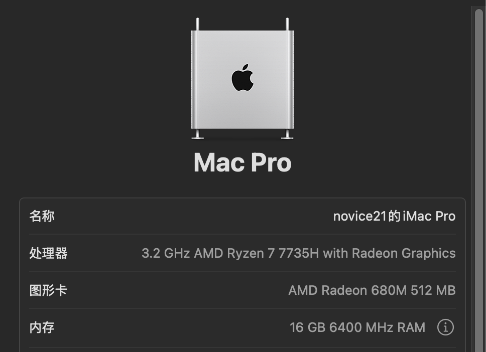

# 机械革命 无界14 2023（R7-7735H / Radeon 680M）Hackintosh — Radeonized 分支

**macOS Sequoia 15.8.3（24H241）· OpenCore · SMBIOS `MacPro7,1` · 分支：`radeonized-680m`**

> **本分支是 Radeonized 实验方案；`main` 仍是 RembrandtGfx 的稳定基线。**
> 本分支把显卡驱动换成了 [Radeonized](https://github.com/FranciumOS-org/Radeonized) v0.1.1：680M 以真实 `1002:1681` 出现，不再伪装成 Navi 23，也不再需要 `ATY,bin_image` VBIOS。
> **当前实测：显卡可用（Metal 3）、Wi-Fi 正常、睡眠失效；其他功能未在本分支复测。**
> **本机主观对比：Radeonized 的流畅度低于 `main`（RembrandtGfx），卡顿/掉帧更明显；日常使用请优先 `main`，本分支仅用于实验/参考。**

> **English summary:** Experimental branch using **Radeonized v0.1.1** for the AMD Radeon 680M (native `1002:1681`, no spoof, no VBIOS injection). GPU acceleration works (Metal 3, 2560×1600 @120Hz, HiDPI 1280×800, 512 MB UMA); Wi-Fi works; **sleep is currently broken**; other functions were **not retested** on this branch. The `main` branch remains the RembrandtGfx baseline. Public config contains no real SMBIOS, no VBIOS and no config backups. On this machine Radeonized is **less smooth than `main` (RembrandtGfx)** with more stuttering; use `main` for daily driving and treat this branch as experimental/reference only.

---

## 显卡加速：Radeonized

本分支的显卡驱动来自 **[FranciumOS-org/Radeonized](https://github.com/FranciumOS-org/Radeonized) v0.1.1**（`RembrandtGPU` Lilu 插件 + `RBAMDFramebuffer` IOFramebuffer）。感谢 RembrandtGPU contributors 让 Rembrandt APU 在 macOS 上获得 Metal 加速。



*本机实测截图：AMD Radeon 680M、512 MB（UMA carve-out）、Metal 3。按发布决定使用原图，图中包含维护者本机用户名。*

- 显卡以真实 **`1002:1681`** 出现，不伪装 `0x73FF`，不注入 `ATY,bin_image`
- VBIOS 由插件在启动时从本机 ACPI `VFCT` 表读取，公共仓库不包含任何板卡 VBIOS
- `RBAMDFramebuffer.kext` 安装在 `/Library/Extensions` 并重建 aux KC；安装脚本和手动步骤见 [Radeonized/README.md](Radeonized/README.md) 与 [docs/INSTALL.md](docs/INSTALL.md)

## 硬件

| 部件 | 规格 |
|---|---|
| 机型 | 机械革命 无界14 2023（MECHREVO WUJIE 14 2023） |
| CPU | AMD Ryzen 7 7735H（Rembrandt，Zen3+，8C/16T） |
| 核显 | Radeon 680M（RDNA2，`1002:1681`；本分支由 Radeonized 驱动） |
| 独显 | 无 |
| 内存 | 16 GB LPDDR5-6400 |
| 硬盘 | Intel 660p 512 GB + Fanxiang S690 1 TB（双 M.2 NVMe） |
| 网卡 | Intel AX210（Wi-Fi 6E / 蓝牙） |
| 面板 | BOE NE140QDM-NX2，14"，2560×1600 @120Hz |
| BIOS | AMI 2.22.1282 |
| 系统 | macOS Sequoia 15.8.3（24H241） |

## 当前状态（本分支）

| 功能 | 状态 | 说明 |
|---|---|---|
| 显卡 / Metal | ✅ 可用 | Radeonized v0.1.1；原生 `1002:1681`；Metal 3；2560×1600 @120Hz；HiDPI 1280×800；报告 **512 MB**（UMA carve-out）；加速可用，但本机流畅度见下行 |
| 流畅度 / 卡顿 | ⚠️ 不如 main | 本机主观对比：Radeonized 比 `main`（RembrandtGfx）更容易卡顿/掉帧；日常使用建议 `main` |
| Wi-Fi | ✅ 可用 | AX210 + AirportItlwm；本分支实测正常 |
| 睡眠 / 唤醒 | ❌ 失效 | 当前 Radeonized 方案已知问题；请勿在未保存工作时依赖睡眠 |
| 内屏 / 亮度 | ❓ 未复测 | 内屏显示正常，亮度键未在本分支逐项复测 |
| AirDrop / 蓝牙 | ❓ 未复测 | EFI 保留原有 AirportItlwm AWDL / Intel 蓝牙 kext，未在本分支复测 |
| 音频 / 麦克风 | ❓ 未复测 | 沿用 main 的 VoodooHDA 配置，未在本分支复测 |
| 摄像头 | ❓ 未复测 | — |
| 触控板 | ❓ 未复测 | 沿用 VoodooI2C + VoodooI2CHID 配置 |
| USB / NVMe | ❓ 未复测 | 沿用原 EFI 的 USBToolBox / NVMeFix |
| 外接显示 | ❓ 未复测 | Radeonized 上游当前未打通 USB-C DP 外接 |
| 硬件视频编解码 | ❓ 未复测 | 上游未完成 |
| 指纹 | ❓ | — |
| iMessage / App Store | ❓ 需自行生成三码 | 公开版不含真实三码 |

> `main` 分支上旧的“全部可用”状态表针对 RembrandtGfx 方案，不适用于本分支。

## 2026-11-26 本次更新（`radeonized-680m` 分支）

- 从当前可启动的内置 ESP 同步 EFI；显卡换为 **Radeonized v0.1.1**：
  - `RembrandtGPU.kext` 排在 `Lilu.kext` 之后并启用；
  - `RembrandtGfx.kext` 保留在 `EFI/OC/Kexts` 但 **Disabled**，作为回退；
  - GPU `DeviceProperties` 删除 `device-id 0x73FF` / `model` / `ATY,bin_image` / `CFG_*`，恢复原生 `1002:1681`。
- 新增 `Radeonized/RBAMDFramebuffer.kext`、MIT/AMD 许可证与安装脚本。
- 实测：Metal 3、2560×1600@120Hz、HiDPI 1280×800、512 MB；**Wi-Fi 正常、睡眠失效、其他功能未复测**。 本机主观对比：流畅度低于 `main`（RembrandtGfx），卡顿/掉帧更多；日常使用建议 `main`。
- OpenCore `Resolution` 保持 `2560x1600@32`（Radeonized fb 的面板几何依赖它），`UIScale=2` 让引导图标等比放大。
- 安全：移除 main 上遗留的两个 `config.before-*.plist` 备份（含真实 SMBIOS/ROM 与 `ATY,bin_image`），`.gitignore` 增加 `config.before-*.plist`。
- 新增实测截图 `docs/images/radeonized-680m.png`。

## 仓库结构

```text
EFI/
  BOOT/BOOTx64.efi, fbx64.efi, mmx64.efi
  OC/
    config.plist          # 四码为空、无 ATY,bin_image、Radeonized armed
    ACPI/                 # SSDT-CPUR / EC / EC-USBX / OCMARK / PLUG-ALT-16CPU / PNLF / SBUS-MCHC / XHC-OFF
    Drivers/              # OpenVariableRuntimeDxe / OpenRuntime / OpenHfsPlus / OpenCanopy / ResetNvramEntry
    Kexts/                # Lilu、RembrandtGPU、RembrandtGfx(Disabled)、Wi-Fi/BT/音频/触控板等
    Resources/            # OpenCanopy 主题
    Tools/OpenShell.efi
Radeonized/
  RBAMDFramebuffer.kext   # 安装到 /Library/Extensions
  LICENSE                 # 上游 MIT
  LICENSE.amdgpu          # AMD 微码二进制许可
  THIRD-PARTY.md
  README.md               # 安装与 UUID 说明
docs/
  INSTALL.md              # 安装、SMBIOS、framebuffer、aux KC、首次启动
  GPU.md                  # Radeonized / 512 MB / 限制
  TOUCHPAD.md             # 触控板（main 基线，未在本分支复测）
  AIRDROP.md              # AX210 AirDrop/AWDL（main 基线，未在本分支复测）
  COMPONENTS.md           # 组件版本、上游与许可证
  HISTORY.md              # 完整折腾记录
  images/radeonized-680m.png
CHANGELOG.md
LICENSE                   # 本仓库文档/配置 MIT
THIRD_PARTY_NOTICES.md
scripts/
  sanitize-config.py
  install-radeonized-framebuffer.sh
```

## 快速开始

1. **生成自己的三码**（必需）：用 `macserial` 或 GenSMBIOS 生成 `MacPro7,1` 的 `SystemSerialNumber`、`MLB`、`SystemUUID`、`ROM`，填入 `EFI/OC/config.plist → PlatformInfo/Generic`。公开版四码为空，**不要使用他人的三码**。
2. **准备 EFI**：把仓库 `EFI/` 放到 FAT32 U 盘或 ESP 根目录；`EFI/BOOT/BOOTx64.efi` 必须在。
3. **安装 framebuffer**：进入 macOS 后，在本仓库根目录执行（需 SIP/AMFI 已放松）：
   ```sh
   sudo ./scripts/install-radeonized-framebuffer.sh
   ```
   脚本会安装 `RBAMDFramebuffer.kext`、重建 aux KC、备份并回读校验 UUID。手动步骤见 [docs/INSTALL.md](docs/INSTALL.md)。
4. **BIOS**：关闭 Secure Boot / Fast Boot，使用 UEFI 启动（BIOS 2.22.1282）。
5. **首次启动**：选择 macOS 卷；进入桌面后确认：
   ```sh
   system_profiler SPDisplaysDataType
   ioreg -rl -c RembrandtGPUPeer | tr ',' '\n' | grep -E '"(armed|arm_why|vbios_src|acpivbios)"='
   ```
   预期 `AMD Radeon 680M`、Metal 3、512 MB、`armed=1`、`vbios_src=3`。
6. **Wi-Fi**：AX210 + AirportItlwm，本分支实测正常；不要同时启用 `itlwm.kext`。
7. **睡眠**：当前失效，先不要依赖；需要时用关机/重启替代。
8. **急救盘**：保留一个与内置 EFI 同版本的 U 盘 EFI；更新前备份旧 `EFI` 与 `/Library/KernelCollections/AuxiliaryKernelExtensions.kc`。

> **体验提示：** 本机 Radeonized 流畅度低于 `main`（RembrandtGfx），卡顿更多；日常使用建议 `main`。

## 关键配置

| 项 | 值 |
|---|---|
| 显卡 | Radeonized v0.1.1；原生 `1002:1681`；无 `ATY,bin_image`；报告 512 MB UMA |
| 插件 | `RembrandtGPU.kext`（`com.rembrandtgpu.plugin`，UUID `E3A30962-A898-38B4-856D-402EE1FD0D50`） |
| Framebuffer | `RBAMDFramebuffer.kext`（`com.rembrandtgpu.fb`，UUID `31B2C56B-0FC6-3F8F-85C1-7DD4A2FBAFA1`） |
| 内屏 | 2560×1600 @120Hz；HiDPI 1280×800 |
| OpenCore 输出 | `Resolution = 2560x1600@32`；`UIScale = 2` |
| SIP / AMFI | `csr-active-config = 0x0FFF`；`amfi=0x80` / `amfi_get_out_of_my_way=0x1`；`SecureBootModel = Disabled` |
| boot-args | `-lilubetaall debug=0x100 keepsyms=1 -no_compat_check -no_restart amfi_get_out_of_my_way=0x1 amfi=0x80 ipc_control_port_options=0 itlwm_he=1 ocax210seq1 -rmbxhciintr1 msgbuf=4194304 revpatch=cpuname,memtab revcpu=1 -itlawdl -itlawdlaw -itlawdllisten -itlawdlp2p -itlawdltx -itlawdldata -itlawdlpromisc -itlawdltxpump itlawdllead=30000 -itlawdlfollow -btlfxadvsets -itlawdlanybuild -btlfxadvsetsany -rbgpufbnative -rbgpufbhidpi -rbgpuvbl -rbgpuvblpump -rbgpufbvbl rbgpuvblhz=119807Hz -rbgpufbaux` |
| 面板特定参数 | `rbgpuvblhz=119807Hz`（本机 120Hz 面板）、`-rbgpufbaux`（AUX 武装）、`-rbgpufbhidpi`；换面板/刷新率时需调整 |
| Wi-Fi | AX210 + AirportItlwm（AWDL 构建）；`itlwm.kext` 关闭 |

## 已知问题

- **睡眠 / 唤醒失效**：当前 Radeonized 方案已知问题；请先保存工作。
- **其他功能未复测**：AirDrop、蓝牙、音频/麦克风、摄像头、触控板、USB、NVMe 等沿用 main 的 kext，但未在本分支逐项验证。
- **512 MB 显存**：UMA carve-out，当前 BIOS 无法调整；显存 heap 偏紧时会退到 GART，重负载可能卡顿。
- **外接显示 / 硬件视频编解码**：Radeonized 上游当前未打通。
- **系统信息可能显示 42"**：fbkext 未把 EDID 交给 IODisplay，物理尺寸显示为默认值；不影响实际 2560×1600/120Hz。本仓库不收录修改该显示的 override。
- **实验性 / 流畅度**：Radeonized 上游仍标注偶发 stall；本机实测流畅度低于 `main`（RembrandtGfx），卡顿/掉帧更明显，不限于重负载。日常使用建议 `main`，本分支仅作实验/参考。
- **未做进一步调优**：60Hz + `rbgpuvblhz=60000Hz` 等性能对比未完成；不要把未验证的调优当成结论。
- **公开版不含三码与 VBIOS**：必须自行生成 SMBIOS；VBIOS 由 ACPI `VFCT` 在启动时读取。
- **截图隐私**：`docs/images/radeonized-680m.png` 为原图，含维护者本机用户名。

## 安全与合规

- 本分支已在 tip 移除 main 上遗留的两个 `config.before-*.plist` 备份（包含真实 SMBIOS/ROM 与 `ATY,bin_image`），并在 `.gitignore` 增加 `config.before-*.plist`。
- 但这两个文件仍存在于 main 及其历史、fork、缓存和搜索引擎索引中；**旧 SMBIOS/ROM 请视为已泄露**，维护者应继续使用新三码。彻底清理 main 历史需要单独重写/force-push，不在本分支范围。
- 公开树不包含真实序列号、`ATY,bin_image`、OpenCore 日志、NVRAM、SysReport、config 备份。
- 本仓库原创文档与配置使用 MIT；Radeonized 代码为 MIT，内嵌 AMD 微码按 `Radeonized/LICENSE.amdgpu` 二进制再分发；其他第三方 kext 按各自许可证分发，见 [THIRD_PARTY_NOTICES.md](THIRD_PARTY_NOTICES.md)。

## 参考与致谢

- **显卡方案：[Radeonized](https://github.com/FranciumOS-org/Radeonized) v0.1.1（MIT；AMD 微码见 `Radeonized/LICENSE.amdgpu`）— 感谢 RembrandtGPU contributors。**
- 回退方案 / main 基线：RembrandtGfx 0.1.0，来源 <https://github.com/caoshiyuan0211-blip/winmax2-2022-6800u-hackintosh>（GPL-2.0）
- 触控板配置参考：<https://github.com/PiyushAdy/Thinkbook_G7_7735HS_680M_Hackintosh>
- AirDrop/AWDL（AX210）：<https://github.com/kevineduardo/ax210-airdrop-awdl-hackintosh>（kexts GPL-2.0 / tools MIT）
- [Acidanthera](https://github.com/acidanthera)：OpenCore、Lilu、VirtualSMC、NVMeFix、RestrictEvents、BrightnessKeys、AppleALC、VoodooPS2
- [VoodooI2C](https://github.com/VoodooI2C/VoodooI2C)：VoodooI2C / VoodooI2CHID
- [OpenIntelWireless](https://github.com/OpenIntelWireless)：AirportItlwm、IntelBluetoothFirmware
- [dhinakg/AMFIPass](https://github.com/dhinakg/AMFIPass)、[USBToolBox](https://github.com/USBToolBox/kext)
- Dortania OpenCore Install Guide（AMD 配置）

## 免责声明

黑苹果属于非官方改装，Apple 不提供支持。使用本仓库造成的系统不稳定、数据丢失、硬件问题或 Apple 服务限制，由使用者自行承担。安装前请完整备份 EFI 与数据，并遵守 macOS 软件许可协议。
